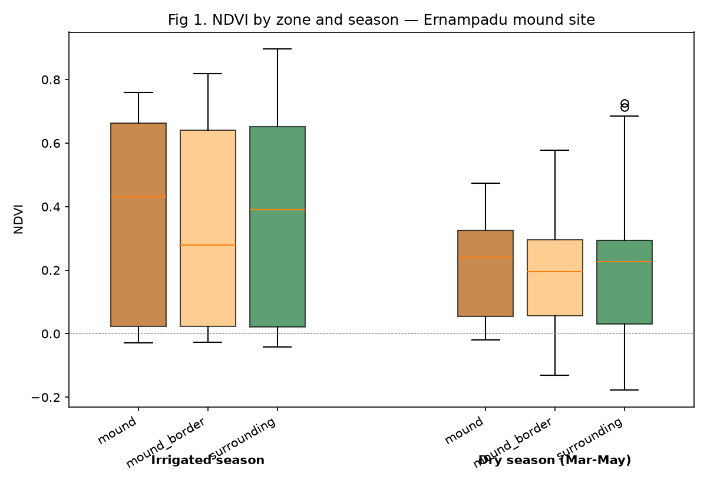

# Project 4: Hypothesis Generation & Validation
Rao Talasila

## Step 1) Hypothesis

### Primary:

Within actively irrigated lands, buried Stupa mounds emit lower NDVI
(Normalized Difference Vegetation Index) values than the surrounding
irrigated lands, with gap widening during the dry low-rainfall season
(March-May).

### Secondary:

A fine-tuned model trained on pre-trained satellite imagery embeddings
and NDVI values can find other undiscovered mounds in Andhra Pradesh,
India

### Null hypothesis:

The buried stupas emit NDVI values similar to the surrounding irrigated
lands

### Alternative explanation:

The mounds are a result of recent human activity where construction or
agricultural debris was piled into mounds. It could also be a result of
a natural geologically formed mound

## Step 2) Variables

The key variables to test the primary hypothesis are

## Input Variables:

**patch_id**: unique identifier to identify the patch in the mound

**zone**: this is the label that can take 3 values: mound, mound_border,
surrounding . This is the **weakest link** as the mound_border is
classified as a value above 15 meters from the center of the mound, and
surrounding is classified as 35 meters from the center of the mound.
These values are assumptions and may be different than at the actual
archeological site.

**date**: the date on which the image was taken by the satellite

**ndvi**: this is the computed NDVI value based on the formula,
B08_value - B04_value/ (B08_value + B04_value) where B08_value is the
Near Infrared Value (NIR) B04_value is the Band Red value

**lat**: this is the latitude of the patch

**lon**: this is the longitude of the patch

**embedding_vec**: this is the embedding of this patch from the DOFA
Encoder. **Currently these values are missing**, but can be generated
through the DOFA Encoder when needed

``` python
import pandas as pd

MOUND = "ernampadu"
df = pd.read_csv(f"{MOUND}_variables.csv")

# print the first 5 rows of the columns
#| output: asis
print(df[["patch_id", "zone", "date", "ndvi", "embedding_vec"]].head().to_markdown(index=False))
```

    | patch_id        | zone        | date       |     ndvi |   embedding_vec |
    |:----------------|:------------|:-----------|---------:|----------------:|
    | ernampadu_r0_c0 | surrounding | 2024-01-01 | 0.279509 |             nan |
    | ernampadu_r0_c1 | surrounding | 2024-01-01 | 0.289272 |             nan |
    | ernampadu_r0_c2 | surrounding | 2024-01-01 | 0.291005 |             nan |
    | ernampadu_r0_c3 | surrounding | 2024-01-01 | 0.288591 |             nan |
    | ernampadu_r0_c4 | surrounding | 2024-01-01 | 0.279768 |             nan |

## Step 3) A first look without machine learning



Figure 1 shows the box plot of NDVI values for the three classes (mound,
mound_border, surrounding) across two seasons (Irrigated, Dry)

An archeologist would conclude from this figure that the box plots fail
to support the hypothesis by saying 1) The box plots in both the seasons
show data cannot distinguish between the three classes; 2) The NDVI
values in Dry season is showing the opposite direction from the
hypothesis.

However the box plot should be seen in the context of the small sample
size data downloaded from Sentinel-2:

1)  Only data for one mound was downloaded. This is a small dataset in
    addition to a large class imbalance (7, 33, 860): 7 unique mound
    pixels, 33 mound_border pixels, and 860 surrounding pixels
2)  Data downloaded was limited to the Jan-June 2024 period and hence
    results are biased to any special weather and crop patterns during
    that period
3)  the zone boundary thresholds (15m mound, 35m mound_border radius)
    were arbitrarily picked

I expect the AI method run on a larger dataset with wider time periods
across many years and with multiple mounds should show better insights
on whether the data supports the hypothesis

## Step 4) Predictions

Since this is a classification problem of determining if a pixel belongs
to a mound, AUC (Area Under Curve) will be the benchmark metric to judge
the result. Once a satisfactory AUC is obtained on known mounds, the
next objective can move to predicting new mounds from a larger
geographical area

If my primary hypothesis is right, the AUC value for a **mound vs
surrounding** would have a value greater than 0.5 on held-out known
sites

If null hypothesis is right, the AUC value will be close to 0.5 on the
held-out known sites

If my alternative explanation is right, AUC value will be greater than
0.5 on held-out known sites, but the output from new predictions on
mounds, but visually verified as false positive such as a
non-archeological pixel
