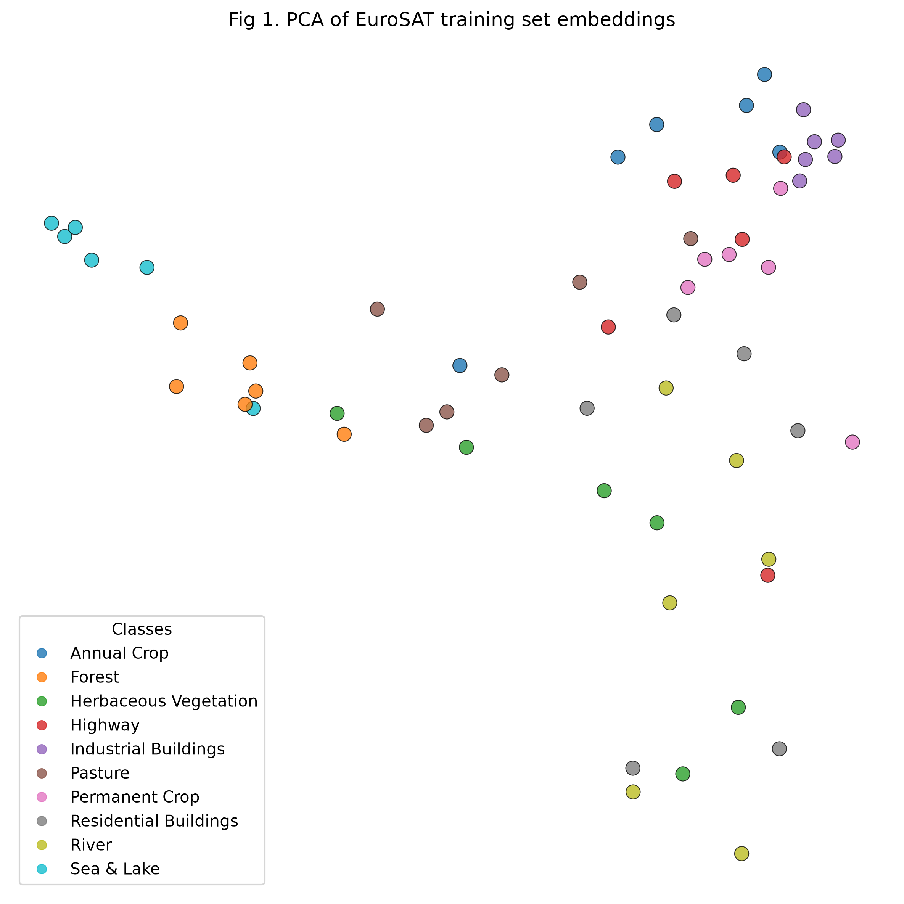

# Learning the use of pre-trained Transformers in Python
Rao Talasila

## Introduction

The Python Tutorial being followed is: TorchGeo official tutorials
(“Introduction to PyTorch,” “Introduction to Geospatial Data,”
“Introduction to TorchGeo”) —
https://torchgeo.readthedocs.io/en/latest/tutorials/getting_started.html
.

The relevant section of the tutorial describes the extraction of
embeddings from a pretrained Visual Transformer (ViT) model trained on
remote satellite images, and the use of embeddings to classify new
images. This is described in
https://docs.torchgeo.org/en/latest/tutorials/embeddings.html

The below paper also uses a similar ViT model for performing heritage
value evaluation of sites in Shaanxi province, China. Instead of using a
pretrained model, they train a Visual Transformer model from 30,000
images across 10 value categories. The values for the 10 categories were
inferred from a Latent Dirichlet Association (LDA) topic model

Xu, W., Huang, B., Tang, Y., Shi, C., Wang, Y., Kong, S., & Yan, P.
(2025). ViT-HVE: A vision transformer-based framework for recognition
and weighted evaluation of cultural heritage values. npj Heritage
Science, 13, Article 571. https://doi.org/10.1038/s40494-025-02143-6

## Tutorial

The Tutorial in Python walks through the steps in loading a EuroSAT
dataset using TorchGeo’s Lightning DataModule, and the use of a
pretrained Visual Transformer (ViT) model named DOFA to obtain the
embeddings.

### The conda environment (stupa-classication) for Python is expected to have installed the following packages

torchgeo scikit-learn tqdm libgdal-jp2openjpeg

### Import a small 100-image EuroSAT dataset

``` python
import os
import tempfile

import kornia.augmentation as K
import matplotlib.pyplot as plt
import numpy as np
import torch
from sklearn.decomposition import PCA
from sklearn.metrics import classification_report
from sklearn.neighbors import KNeighborsClassifier
from tqdm import tqdm

from torchgeo.datamodules import EuroSAT100DataModule
from torchgeo.datasets import EuroSAT100
from torchgeo.models import DOFABase16_Weights, ResNet18_Weights, get_model
```

### Download the EuroSAT100 dataset and set the train/validation splits

``` python
# Build EuroSAT DataModule (train/val loaders) using TorchGeo Lightning utilities.

root = os.path.join(tempfile.gettempdir(), 'eurosat100')
# ensure that the dataset is download
EuroSAT100(root=root, split='train', download=True)
EuroSAT100(root=root, split='val', download=True)

datamodule = EuroSAT100DataModule(
    root=root, batch_size=10, num_workers=2, bands=('B02', 'B03', 'B04')
)
datamodule.setup('fit')
datamodule.setup('validate')

train_dl = datamodule.train_dataloader()
val_dl = datamodule.val_dataloader()
```

### Load the pretrained ViT encoder called DOFA

``` python
accelerator = 'cuda' if torch.cuda.is_available() else 'cpu'

# Load the DOFA pretrained encoder (ViT-style) and move it to device.

model = get_model('dofa_base_patch16_224', weights=DOFABase16_Weights.DOFA_MAE)
model = model.eval().to(accelerator)

augs = K.AugmentationSequential(
    K.Normalize(
        mean=0.0, std=10_000, p=1.0
    ),  # Divide by 10,000 to approximately scale to [0, 1]
    K.Resize((224, 224), antialias=True),  # DOFA model expects 224x224 inputs
)
def embed_dofa(model, dataloader, accelerator, transforms=None):
    """Helper function to embed the samples from a dataloader using a DOFA model."""
    x_all = []
    y_all = []
    for batch in tqdm(dataloader):
        x = batch['image'].to(accelerator)
        y = batch['label']
        x = x.to(accelerator)
        if transforms is not None:
            x = transforms(x)

        with torch.inference_mode():
            # DOFA requires us to forward the central wavelengths of each bands
            # these are B02, B03, B04 wavelengths for Sentinel-2
            embeddings = model.forward_features(x, wavelengths=[0.49, 0.56, 0.66])
        x_all.append(embeddings.cpu().numpy())
        y_all.append(y.numpy())
    x_all = np.concatenate(x_all, axis=0)
    y_all = np.concatenate(y_all, axis=0)
    return x_all, y_all
```

### Obtain the embeddings from the pre-trained DOFA model on the EuroSAT100 images. Since this is a small dataset of 100 images, the operation is completed within 20 seconds

``` python
x_train, y_train = embed_dofa(model, train_dl, accelerator, transforms=augs)
x_val, y_val = embed_dofa(model, val_dl, accelerator, transforms=augs)
```

      0%|          | 0/6 [00:00<?, ?it/s]
     17%|█▋        | 1/6 [00:06<00:32,  6.58s/it]
     33%|███▎      | 2/6 [00:08<00:14,  3.55s/it]
     50%|█████     | 3/6 [00:09<00:07,  2.55s/it]
     67%|██████▋   | 4/6 [00:10<00:04,  2.03s/it]
     83%|████████▎ | 5/6 [00:11<00:01,  1.72s/it]
    100%|██████████| 6/6 [00:12<00:00,  1.53s/it]
    100%|██████████| 6/6 [00:12<00:00,  2.15s/it]

      0%|          | 0/2 [00:00<?, ?it/s]
     50%|█████     | 1/2 [00:05<00:05,  5.31s/it]
    100%|██████████| 2/2 [00:06<00:00,  3.01s/it]
    100%|██████████| 2/2 [00:06<00:00,  3.36s/it]

### Fit a kNN Classifier on the train embeddings obtained from DOFA model and evaluate on its validation embeddings

``` python
knn_model = KNeighborsClassifier(n_neighbors=5)
knn_model.fit(x_train, y_train)
y_pred = knn_model.predict(x_val)
```

### Print the classification report to obtain the Precision & Recall scores on the validation set as per each class

``` python
class_names = [
    'Annual Crop',
    'Forest',
    'Herbaceous Vegetation',
    'Highway',
    'Industrial Buildings',
    'Pasture',
    'Permanent Crop',
    'Residential Buildings',
    'River',
    'Sea & Lake',
]

print(
    classification_report(
        y_val, y_pred, digits=2, target_names=class_names, zero_division=0
    )
)
```

                           precision    recall  f1-score   support

              Annual Crop       0.50      0.50      0.50         2
                   Forest       0.50      1.00      0.67         2
    Herbaceous Vegetation       0.33      0.50      0.40         2
                  Highway       0.50      0.50      0.50         2
     Industrial Buildings       1.00      1.00      1.00         2
                  Pasture       0.50      0.50      0.50         2
           Permanent Crop       0.00      0.00      0.00         2
    Residential Buildings       1.00      1.00      1.00         2
                    River       0.50      0.50      0.50         2
               Sea & Lake       1.00      0.50      0.67         2

                 accuracy                           0.60        20
                macro avg       0.58      0.60      0.57        20
             weighted avg       0.58      0.60      0.57        20

### Observations from the above classification report:

1)  Industrial & Residential Buildings both have a high-precision of 1.0
    and high-recall of 1.0. This implies that the contours of these two
    classes are easily distinguishable in satellite images compared to
    other geographic features.
2)  The Sea & Lake class has a high-precision of 1.0, but the recall of
    0.5 implies that the model is misclassifying non-water surfaces as
    water such as River
3)  The overall accuracy is 0.60, it is a reasonably good value
    considering that the validation set has 20 images (and with the
    training set of 80 images)

### Obtain a PCA plot on the train embeddings to view the class clusters

``` python
pca = PCA(n_components=2, whiten=True)
x_reduced = pca.fit_transform(x_train)
print(f'Explained variance ratio: {pca.explained_variance_ratio_.sum()}')

fig = plt.figure(figsize=(8, 8))
ax = plt.gca()
scatter = plt.scatter(
    x_reduced[:, 0], x_reduced[:, 1], c=y_train, cmap='tab10', s=80, alpha=0.8,
    edgecolors='k', linewidths=0.5
)
handles, _ = scatter.legend_elements()
labels = [class_names[i] for i in range(10)]
plt.legend(handles, labels, title='Classes', loc='best')
plt.title('Fig 1. PCA of EuroSAT training set embeddings')
plt.axis('off')
plt.tight_layout()
plt.savefig('images/eurosat_pca.png', dpi=300, bbox_inches='tight')
# plt.show()
plt.close()
```

    Explained variance ratio: 0.5778067111968994



### Observations from Fig 1

1)  Sea & Lake classes are clustered on the upper left indicating their
    strong distinguishable features from the rest of classes
2)  The distinct cluster of Industrial buildings can also be seen on the
    upper right

### How this method works

1)  What goes in?

Each data point in the training/validation dataset is 2-tuple
(image,label). The image is a .tif file that is a 13-band Sentinel-2
multispectral image. The 13-bands include data from the 3 RGB bands.
Each image tile has 13-dimensional band data in 64x64 pixels format
representing a 640m x 640m ground area at 10m/pixel resolution. The
label is one of the 10 classes such as Annual Crop, Industrial
Buildings, River, Sea & Lake, Residential Buildings, and others

2)  What comes out? Groups (clusters)? A predicted category? A
    probability? A plot?

The DOFO model obtains the embeddings for each of the images. Each
embedding is a 768 dimensional vector

3)  Supervised or unsupervised?

Does the method learn from examples where we already know the answer (a
label), or does it look for patterns without one? The KNN method used
here is a supervised method as the embeddings to a known label. The
pre-trained DOFO model (a Visual Transformer) is however an unsupervised
model that is trained on patches of satellite images, this is achieved
by masking certain parts of the patches and let the model recover the
masked parts

4)  How do we know if the result is any good? What does the tutorial use
    to check the result?

The tutorial uses the overall accuracy ratio of the KNN Classifier to
estimate the goodness of the model. In the tutorial the accuracy of 0.6
is considered reasonably good considering the small size of the
train/validation dataset

## My data

Out of the 3 datasets originally proposed in Project 1, only the
Sentinal-2 dataset is in a shape to be directly processed by TorchGeo
libraries with limited code changes

Sentinel-2 (Level-2A surface reflectance) European Space Agency. 2021.
“Copernicus Sentinel-2 MSI Level-2A (L2A), Collection 1.” Dataset.
Copernicus Data Space Ecosystem. https://doi.org/10.5270/S2\_-znk9xsj.

Since satellite imagery can occupy terabytes of data, I downloaded only
a small dataset around an Area of Interest (AOI) of a small region
around the city of Vijayawada in India. This dataset was downloaded
through https://dataspace.copernicus.eu/ that has vast amounts of
Sentinel-2 data

The 1.14 GB downloaded file is
S2C_MSIL2A_20260305T045701_N0512_R119_T44QMD_20260305T102020.SAFE.zip .

### What would change for my archeaeological data?

The data that is of interest is with 10m resolution (IMG_DATA/R10m).
Each .tif file is a 10,980 x 10,980 pixel tile. This tile has to be
cropped to a 224 x 224 patch in order for the pre-trained DOFA model to
handle it. The 224x224 patch covers a 2.24kmx2.24km area of interest.
